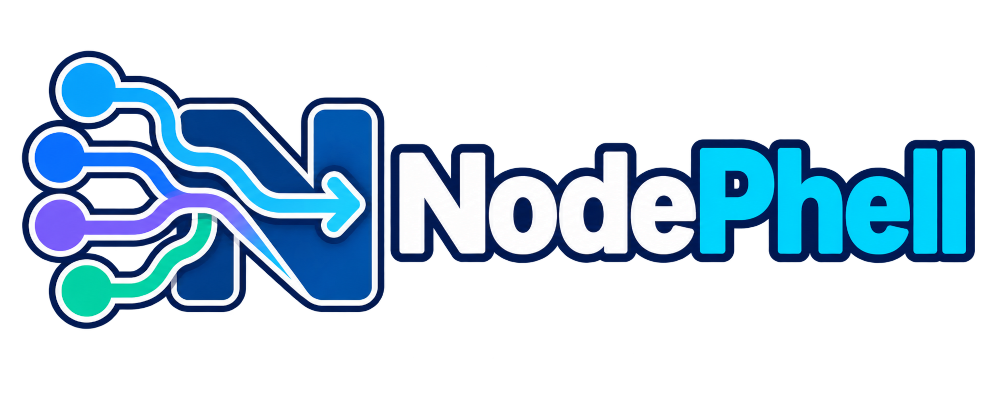

<!-- SPDX-License-Identifier: GPL-3.0-only -->



# NodePhell

**No dependency hell. No virtual environments. Just run Python.**

NodePhell is an open-source Python dependency and interpreter manager for Linux, built around the idea that managing Python environments shouldn't be a hobby in itself. We have plenty of other things we'd rather be doing.

A project describes which version of Python and which packages it needs. NodePhell works out the details, downloads and verifies anything that's missing, and keeps it all available for future projects.

Once your project is set up, using it is as simple as:

```bash
python app.py
```

There's nothing to activate, no virtual environment to maintain, and no need to modify your operating system's Python.

Old projects can keep using the versions of Python they were written for. New projects can use newer releases. If two projects need the same packages, why install them twice?

NodePhell can even help applications that embed their own Python interpreter, such as FreeCAD, through an optional adapter system.

## Why NodePhell?

Getting Python software running often involves a surprising amount of work:

- Find and install the right version of Python.
- Create a virtual environment.
- Activate it.
- Install another copy of the dependencies.
- Remember which environment belongs to which project.
- Repair or rebuild things when something changes.

And then do it all over again for the next project.

NodePhell takes a different approach:

- Download each required version of Python and its packages once.
- Record exactly what each project needs in a lockfile.
- Automatically make those versions available when the project runs.
- Reuse anything that's already on your computer.

Your projects still get their own precise set of dependencies, but they don't need their own private copies of everything.

**Isolation comes from selection, not duplication.**

NodePhell isn't another virtual environment manager. It's an alternative to needing virtual environments in the first place.

## One Python history, shared

There's no reason an older Python project should stop working just because you installed a newer version of Python for something else.

NodePhell keeps multiple versions of CPython available and automatically selects the one your project needs.

Packages work the same way. If a project needs a version of a package you already have, NodePhell uses it. If it needs a different version, NodePhell gets that one too.

Here's a simplified example of how several projects can share Python interpreters and packages:

```text
                    NodePhell's shared store

CPython 3.11         ──┬── Project A
                       └── Project B

CPython 3.13         ───── Project C

lark 1.3.0           ──┬── Project A
                       ├── Project B
                       └── Project C

requests 2.32        ──┬── Project A
                       └── Project C

NumPy cp311 build    ──┬── Project A
                       └── Project B

NumPy cp313 build    ───── Project C

```

Some packages can even be shared across different Python versions. Packages that contain native code and require a particular Python ABI or platform build are kept separate when necessary.

NodePhell takes care of that distinction for you.

The more Python software you use, the more likely it is that you already have everything your next project needs.

## Getting started

NodePhell itself currently requires Python 3.11 or newer. That doesn't mean your projects do.

Clone the repository and install the launchers directly from the checkout:

```bash
git clone https://github.com/JustTryingToGetSomeWorkDone/NodePhell.git
cd NodePhell
./bin/nodephell launcher install
nodephell --version
```

If you'd also like to use NodePhell with FreeCAD, install the optional adapter:

```bash
nodephell plugin add ./plugins/freecad
```

Keep the checkout: the installed commands run its source directly. To update:

```bash
git pull --ff-only
./bin/nodephell launcher install
nodephell --version
```

If another Python command takes priority over NodePhell's launcher, the installer can adjust your Bash startup configuration to put `~/.local/bin` first. Open a new terminal after accepting the change, or follow the instructions provided by the installer to refresh your current session.

That's the initial setup. You only need to do it once.

## Everyday use

### Running an existing project

Already have a Python project with a `pyproject.toml`? Open a terminal in the project directory and run:

```bash
nodephell sync
```

NodePhell will work out which version of Python and which packages the project needs, generate a lockfile if necessary, and download anything you don't already have.

Then run the project as you normally would:

```bash
python app.py
```

And the next time you want to run it? Just run it. There's nothing to activate.

### Starting a new project

Run:

```bash
nodephell init
```

### Downloaded some code without a dependency file?

From the project folder, run:

```bash
nodephell discover
```

NodePhell reads the imports in its Python files and walks you through a
suggested dependency list. You can correct package names, skip optional
imports, and enter versions from the project's instructions. It shows the
proposed `pyproject.toml` before writing anything. Then run `nodephell sync`
to resolve and install the dependencies.

If a `pyproject.toml` already exists, discovery reports possible omissions
without changing it. Existing requirements files are offered as an alternative
input. Discovery does not execute the project or download packages.

Import-name exceptions live in `assets/import-mappings.toml`, rather than the
scanner code. To keep your own additions outside the checkout, use
`nodephell discover --mappings /path/to/mappings.toml`. Application-module hints
are applied only with matching project host metadata or `--application NAME`.

### The dependency declaration

NodePhell uses standard Python dependency declarations, so a simple `pyproject.toml` might look like this:

```toml
[project]
name = "example"
version = "0.1.0"
requires-python = ">=3.13,<3.14"
dependencies = [
    "lark",
    "requests>=2.32,<3",
]
```

You don't need to work out every dependency of every package yourself. That's NodePhell's job.

When you change your project's requirements, run:

```bash
nodephell sync
```

### Optional dependencies

Some projects provide optional features or development dependencies. Rather than working through a list of installation commands, you can simply run:

```bash
nodephell options
```

NodePhell presents a terminal checklist where you can choose the features you want. Your choices are recorded in the project's lockfile, and the dependencies are synchronized for you.

Changing your selection affects only the current project. Packages shared with other projects are left alone, and unused packages are kept by default unless you choose to remove them.

Standard Python optional dependencies and dependency groups are supported, along with older Poetry dependency declarations and groups.

### Projects with special dependency requirements

Not every project has a straightforward `pyproject.toml`. Some have separate requirements files for particular hardware or platforms.

You can tell NodePhell to use one of those instead:

```bash
nodephell sync --requirements requirements-rocm-linux.txt
```

NodePhell remembers your selection, so you don't need to specify it every time.

To return to the project's original dependency declarations:

```bash
nodephell sync --project-dependencies
```

Requirements files retain their normal pip syntax, including nested requirements, constraints, environment markers, package indexes, and supported direct wheel references.

NodePhell also understands supported `uv` index declarations and project-contained editable package sources.

### Working on a project

If a project declares a standard Python build system, NodePhell connects the live source checkout to its selected Python runtime.

You can edit the source code and run it again without reinstalling the project. Its package metadata and commands remain available as expected.

The necessary support files are kept in `~/.python/source-projects`, rather than creating another environment inside the project directory.

### When something doesn't work

If synchronization succeeds but the application refuses to run, try:

```bash
nodephell troubleshoot
```

NodePhell helps reproduce the problem and can try the earliest Python minor version permitted by the project's dependency declaration.

It preserves your original lockfile and asks before keeping a successful alternative.

You can also specify the command you want to troubleshoot:

```bash
nodephell troubleshoot -- frogmouth --help
```

## Finding working dependency configurations

Sometimes the problem isn't installing the dependencies. It's figuring out what they are in the first place.

[NodePhell-Lockfiles](https://github.com/JustTryingToGetSomeWorkDone/NodePhell-Lockfiles) is a companion repository where users can share working dependency declarations and lockfiles for projects with missing, incomplete, or particularly messy dependency configurations.

If someone has already figured out how to get a project running on your hardware, you shouldn't have to figure it out all over again.

And if you've worked out a configuration yourself, consider sharing it with both the upstream project and the lockfile repository.

**Solve a dependency problem once, solve it for everyone.**

## Manage runtimes, packages, and cleanup

To browse what NodePhell knows about and remove entries interactively, run:

```bash
nodephell manage
```

The menu lists runtimes, package releases, projects, and embedded hosts,
including registrations whose files have gone missing. Select entries by
number, review the action, and confirm it. You can unregister a missing build
without deleting anything, remove unused managed files, or run the store
checks and cleanup from the same interface. The individual CLI commands
remain available.

Packages are grouped by name, so you can choose a package before browsing its
versions and builds. Use the left and right arrows to change pages, or press a
letter to jump to names beginning with it. Type a number and press Enter to
open a package; Enter on its own goes back. Colored option numbers and wrapped
paths make the lists easier to read. The main menu also shows the management
Python's version and executable path.

## How NodePhell works

For those interested in what's happening behind the scenes, here's a little more detail.

### Dependency declarations and lockfiles

A `pyproject.toml` describes what a project needs. A lockfile records exactly which versions and package artifacts satisfy those needs.

NodePhell writes a standard `pylock.toml` when the lock conforms to PEP 751. When additional information is needed to reproduce the exact Python interpreter or embedded application environment, it writes a `nodephell.lock.toml` instead.

Both formats record exact package artifacts and their hashes. NodePhell understands either filename, but won't guess which one to use if both are present.

Once a lockfile has been generated, NodePhell uses that exact dependency selection rather than resolving everything again whenever you run the application.

The dependency declaration is editable. The resolved lock is deterministic.

### What happens when Python starts?

When you run Python inside a project that NodePhell is assisting, the launcher does the following:

```text
python app.py
      │
      ▼
Find the project's lockfile
      │
      ▼
Select the locked Python interpreter
      │
      ▼
Locate and verify the locked packages
      │
      ▼
Make the selected packages available
      │
      ▼
Run app.py
```

Packages can come from NodePhell's own package store, the selected Python runtime, or a verified external application's package store.

If an exact compatible copy is already available, NodePhell can reuse it.

Project launches exclude the generic Python user site and inherited `PYTHONPATH`, so unrelated packages on your computer don't interfere with the versions your project needs.

What happens when you run Python on a project without any help from NodePhell?

Nothing unusual. `python` and `python3` continue to use your operating system's Python as before.

### Where does everything go?

NodePhell keeps its files in a predictable directory structure under `~/.python`.

Packages are organized by name, version, wheel filename, and artifact hash. Different builds of the same package version can coexist, and the exact same artifact doesn't need to be installed more than once.

You can browse the files yourself. There's no mysterious database hiding where your packages went.

For more detail about storage, package composition, integrity checks, and cleanup, see the architecture documentation.

### Package commands without activation

Python packages often provide their own terminal commands. NodePhell makes those available without requiring a virtual environment.

If your project includes `pytest`, for example, you can simply run:

```bash
pytest
```

Or:

```bash
python3 -m unittest
```

NodePhell determines which project you're working in and selects the appropriate version of the command.

Different projects can use different versions of the same command without requiring different shells or activated environments.

Only commands properly declared by Python package metadata are exposed.

## What about applications that embed Python?

Not all Python software starts with a `python` command.

Many Linux applications embed their own Python interpreter and maintain their own packages. NodePhell's adapter system allows those applications to benefit from the same dependency management approach.

An adapter provides the application-specific information NodePhell needs:

- How to find the application's Python interpreter.
- Which Python ABI and platform it uses.
- Which packages the application already has.
- How to make additional packages available.
- How to launch the application in command-line or graphical mode.

NodePhell handles the rest, including package selection, compatibility, verification, storage, and reuse.

If an application already contains an exact compatible package, NodePhell can reuse it rather than downloading another copy. Missing packages can be supplied without modifying the application's original package store.

FreeCAD is our current reference adapter. It's a plugin, not a collection of FreeCAD-specific workarounds in NodePhell's core.

Adapters can be installed through Python entry points or placed in NodePhell's local plugin directory. See the adapter documentation if you'd like to extend support to another application.

## What does NodePhell support?

NodePhell currently targets Linux. We're working with the existing Python ecosystem rather than asking every project to change how it declares its dependencies.

Current support includes:

- Multiple CPython versions, including historical releases.
- Standard `pyproject.toml` dependency declarations.
- Unspecified versions, exact versions, and version ranges.
- Standard PEP 508 environment markers.
- Standard optional dependencies and dependency groups.
- Older Poetry dependency declarations and groups.
- Dynamic PEP 621 dependencies provided by build backends.
- HTTPS direct package references.
- Requirements files, including nested files and constraints.
- Supported `uv` named indexes and editable path sources.
- Editable source projects and native packages.
- Python package commands and embedded application adapters.
- Exact artifact locking, integrity verification, and safe package cleanup.

Dynamic dependency declarations require static Python version requirements and optional features so that NodePhell can select the appropriate interpreter before invoking the build backend.

Requirements profiles are fingerprinted, including project-contained files they reference. If an index doesn't provide an artifact hash, NodePhell obtains the exact HTTPS artifact through pip and calculates its SHA-256 before locking it.

VCS dependency sources, arbitrary PEP 621 local paths, and non-editable `uv` path sources are not currently supported.

We're continually testing NodePhell against real software and addressing compatibility issues as we encounter them.

## Project status

Version 0.3.0 adds dependency discovery for
projects without metadata, editable import mappings, and an interactive menu
for browsing and maintaining runtimes, packages, and registrations. See the
[release notes](docs/releases/0.3.0.md) for details.

Real-project validation includes PCB Timelapse's KiCad renderer and ACE-Step's
ROCm music-generation workflow.
JPG_to_PDF also passed the full discovery-to-sync workflow: discovery created
its dependency declaration, synchronization installed from it, and the user
confirmed the project works.

NodePhell has been tested with ordinary Python applications, editable projects, historical Python runtimes, native packages, conflicting dependency versions, shared package storage, and applications with embedded Python.

You can see the projects we've tested, what we found, and how we addressed the problems in the [project compatibility documentation](docs/project-compatibility.md).

That doesn't mean we've tested every Python project in existence. If you encounter something that doesn't work, we'd like to know about it.

Future development is driven by actual use, compatibility needs, and feedback.

## Documentation

There's considerably more information in the [documentation directory](docs/) if you're interested in how NodePhell works or want to do something beyond the basic workflow.

- **User guide** — Installation, everyday commands, cleanup, and troubleshooting.
- **Architecture** — Runtime selection, storage, lockfiles, package composition, and embedded applications.
- **Roadmap** — Release progress and future development.
- **Project compatibility** — Real projects we've tested, findings, and reproduction details.
- **Changelog** — Changes and release information.
- **Host adapter guide** — Writing adapters for applications that embed Python.
- **AI adapter brief** — Implementation guidance for AI coding agents.
- **FreeCAD reference adapter** — Using and developing the FreeCAD plugin.

You can also run:

```bash
nodephell --help
```

Or add `--help` to a particular command to see its available options.

## Philosophy

Most of us don't use Python software because we enjoy installing Python software. We use it because there's something we want to do.

NodePhell exists because we think that getting to that point should be considerably easier.

We follow existing standards wherever possible and extend them where necessary. We don't modify CPython or pip, and we don't want to introduce another mandatory packaging ecosystem.

We want older software to keep working, newer software to be easy to run, and packages to be reusable rather than repeatedly downloaded and installed.

If these ideas eventually become standard Python functionality, all the better.

We just want things to work.

## License

NodePhell is licensed under the GNU General Public License, version 3 only.

SPDX-License-Identifier: GPL-3.0-only

---

**NodePhell — No dependency hell. Just run Python.**
